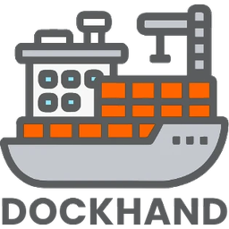

   

  

# Dockhand for Home Assistant

Monitor and control your Docker environments through **[Dockhand](https://dockhand.pro)** — a modern Docker management UI. This integration exposes environments, containers, stacks, networks, images, volumes, and schedules as Home Assistant devices and entities, using the same API as the Dockhand web UI.

No cloud services are used. Supports **API token authentication** and works with Dockhand instances where authentication is disabled.

Want dashboard cards, not just entities? See **[ha-dockhand-cards](https://github.com/raetha/ha-dockhand-cards)** — nine Lovelace cards modeled on Dockhand's own UI (environments, stacks, containers, pending updates, vulnerabilities, schedules, and a whole-dashboard overview), built on top of the entities this integration provides, and a ready-made **[Dockhand dashboard](https://github.com/raetha/ha-dockhand-cards#dockhand-dashboard)** that lays them out for you, with a page for every environment and its stacks and containers.

---

## Requirements

- Home Assistant 2026.8 or later
- Dockhand ≥ 1.0.26 (for API token authentication; no-auth installs work on any version)
- Some features need a newer Dockhand and simply don't appear on older ones: the stack **Updates available** sensor (1.0.37+) and stack resource stats (1.0.52+)
- Dockhand reachable from the HA host

---

## Installation

### Marketplace (Recommended)

Dockhand is in the default catalog of Home Assistant's **Marketplace**, built in from Home Assistant 2026.11 (it grew out of HACS, and uses the same catalog).

1. Go to **Settings → Marketplace**
2. Find **Dockhand** and install it
3. Restart Home Assistant

**Home Assistant 2026.10 and older** have no Marketplace: install [HACS](https://hacs.xyz) yourself, then the steps are the same in HACS (**HACS → Integrations**, find Dockhand, download it, restart).

### Manual

1. Download `dockhand.zip` from the [latest release](https://github.com/raetha/ha-dockhand/releases/latest) and extract it into `<HA config>/custom_components/dockhand/` (create the folder; the zip holds the integration's files directly)
2. Restart Home Assistant

### Test builds

Upcoming changes are published as test builds (pre-releases such as `1.11.5-dev.42`) before they're released, for anyone willing to try them early:

1. Turn on pre-releases for Dockhand: in the Marketplace, open Dockhand and use its **⋮** menu, or turn on the Dockhand **Pre-release** switch (**Settings → Devices & services → Entities**; it's disabled by default, so enable it first). On HACS only the switch is there.
2. The latest test build is then offered as an update; install it and restart Home Assistant
3. To go back to releases, turn pre-releases off again, then open Dockhand, choose **⋮ → Redownload** and pick the latest release

Test builds show their own version (for example `1.11.3-dev.42`) in Home Assistant and in diagnostics, so include it when reporting a problem. The changes in a test build are listed in its [release notes](https://github.com/raetha/ha-dockhand/releases).

---

## Setup

1. Go to **Settings → Devices & Services → Add Integration**
2. Search for **Dockhand**
3. Enter the **API URL** (e.g. `http://dockhand.local:3000`) and SSL preference
4. The integration probes the server. If authentication is enabled you'll be prompted for an **API token** — generate one in Dockhand under **Profile → API tokens**
5. Enable any optional features (schedules, images, volumes, networks, container updates). All of these can be changed later via **Configure**

To change the URL, SSL setting, or API token after setup, use **Reconfigure** (three-dot menu on the integration card)

---

## Use cases

- **Know when something goes down.** Get a phone notification when a container stops, turns unhealthy, or a whole Docker host drops offline, without keeping Dockhand open.
- **Fix the common cases automatically.** Restart a container that has been unhealthy for a few minutes, or start one that a host reboot left stopped.
- **Keep on top of updates.** See pending image updates next to Home Assistant's own updates, install them from there, or get a weekly reminder of stacks with updates waiting.
- **Watch resources.** Chart a host's or a container's CPU and memory over time with Home Assistant's history, and alert when a stack's memory use creeps up.
- **Put your Docker hosts on a dashboard.** The companion [ha-dockhand-cards](https://github.com/raetha/ha-dockhand-cards) show environments, stacks, containers, updates and vulnerabilities the way Dockhand does; add their **Dockhand dashboard** (Add dashboard → Community dashboards) for all of it at once, without placing a card.

---

## Documentation

- **[Configuration](https://github.com/raetha/ha-dockhand/blob/main/docs/configuration.md)**: setup fields and options, API tokens, and the Dockhand permissions a token needs
- **[Devices and entities](https://github.com/raetha/ha-dockhand/blob/main/docs/entities.md)**: how devices are grouped, and every entity for the Dockhand server, environments, containers, stacks, images, volumes, networks and schedules
- **[Actions and automations](https://github.com/raetha/ha-dockhand/blob/main/docs/automations.md)**: `dockhand.prune` and `dockhand.recreate_container`, container and stack controls, and example automations
- **[Data updates](https://github.com/raetha/ha-dockhand/blob/main/docs/data-updates.md)**: what refreshes when, live updates, and refreshing on your own schedule
- **[Troubleshooting and known limitations](https://github.com/raetha/ha-dockhand/blob/main/docs/troubleshooting.md)**

---

## Translations

The integration ships with machine-generated translations for German, Spanish, French, Italian, Norwegian, Dutch, Polish, Portuguese, Swedish, and Chinese (Simplified), alongside the primary English strings. Native speaker corrections and new language additions are welcome — see "Translations" in [docs/development.md](docs/development.md) for how.

---

## Attribution

This integration was developed by **[@raetha](https://github.com/raetha)** with design assistance and code generation by **[Claude](https://claude.ai)** (Anthropic).

---

## License

MIT

## Removal

To remove the Dockhand integration from Home Assistant:

1. Go to **Settings → Devices & services**.
2. Find the **Dockhand** integration card and click on it.
3. Click the three-dot menu (⋮) and select **Delete**.

All devices, entities, and configuration data created by this integration will be removed automatically. No edits to `configuration.yaml` are required. Any automations or dashboard cards referencing Dockhand entities should be updated or removed manually.

### Uninstalling via the Marketplace (or HACS)

After deleting the integration from Settings, go to **Settings → Marketplace** (or **HACS → Integrations** on 2026.10 and older), find **Dockhand**, and remove it. Restart Home Assistant when prompted.
